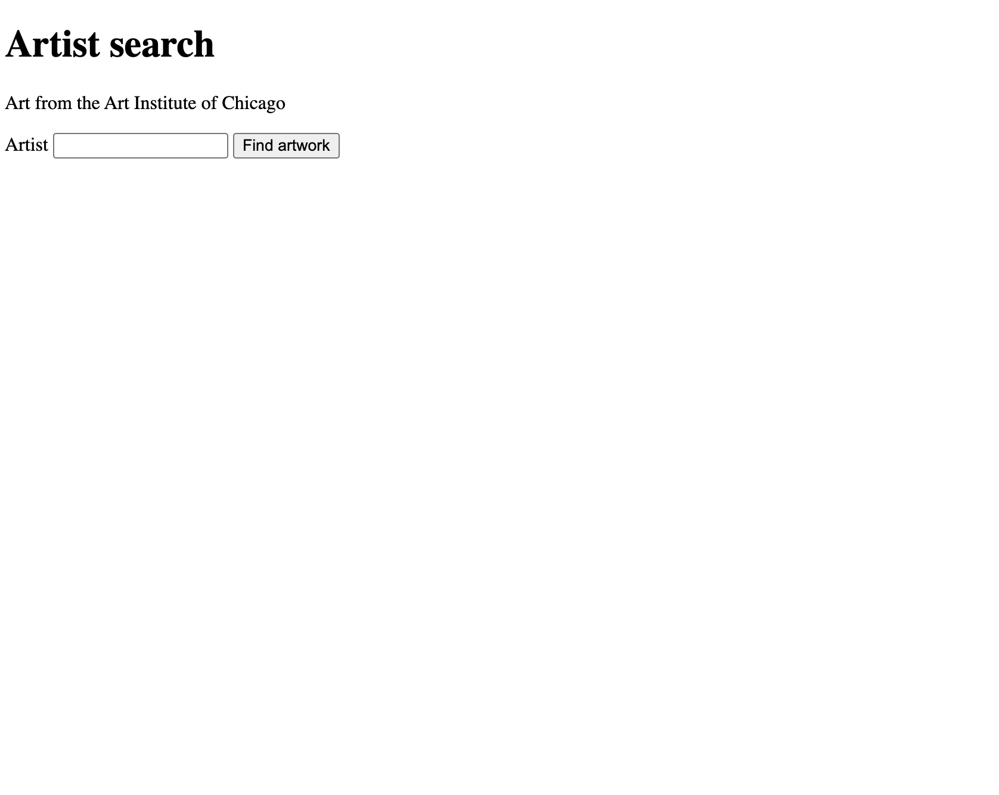
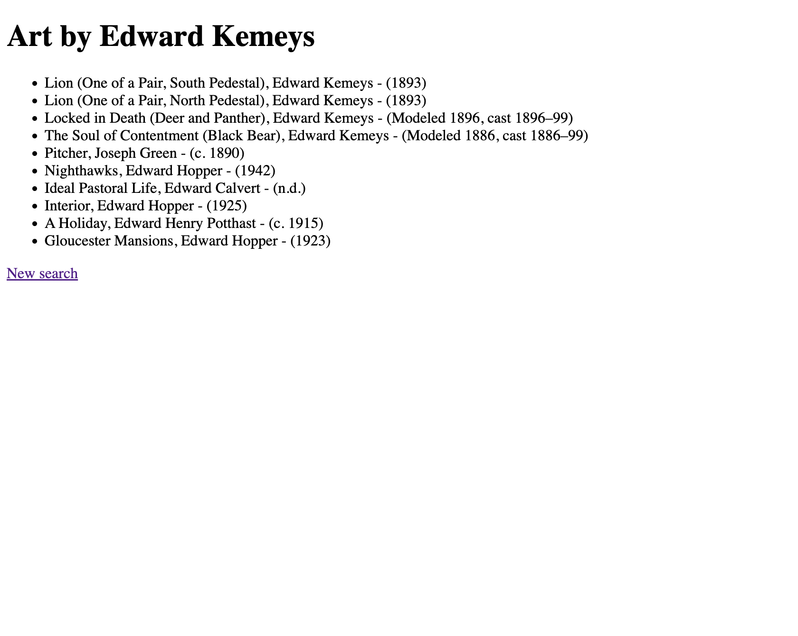

This website is for people who want to do historical research on different artworks from the Art Institute of Chicago, by the artist's name, and receive a list of results. 
Write in the terminal after pressing the run buttin: 
pip install flask requests
flask --app app run --debug --port 5001
then press on the link. It should look like this " * Running on http://127.0.0.1:5001"
Put this link into the browser 

there you will see the home page:

After seraching for an artist you will se the results page:

