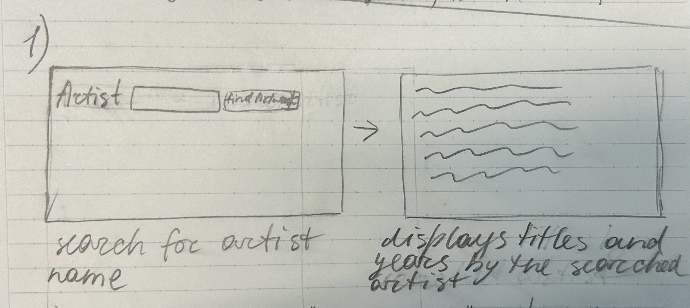

1. 

2. I need the fields: title, artist_title, and date_display.

3. SPECS:
route for "/" (home page).
in: the user just opens the site
out: home.html template -- the search page with "artist" next to it, and a search button.
checks: 
1) opening the website and making sure that the search bar and submit button appear.
2) search an artist name and see if, after submitting it, the result page appears.

#route for "/results"
in: the user presses the button "Find Artwork" from the home.html page
out: the list of the artworks of that artist (result.html page)
checks: 
1) send an empty search bar and see what happens.
2) search for an artist name and see if the artworks match it.
3) break the API on purpose to see if the program will show the helpful message.

#search_art(term) function in api.py:
in: take the artist's name (from (term))
out: list of artworks or none if status code isn't 200
checks:
1) Type an artist name in the search bar and see if I receive a list of artworks
2) Send an empty search bar to check if the helpful message appears.

